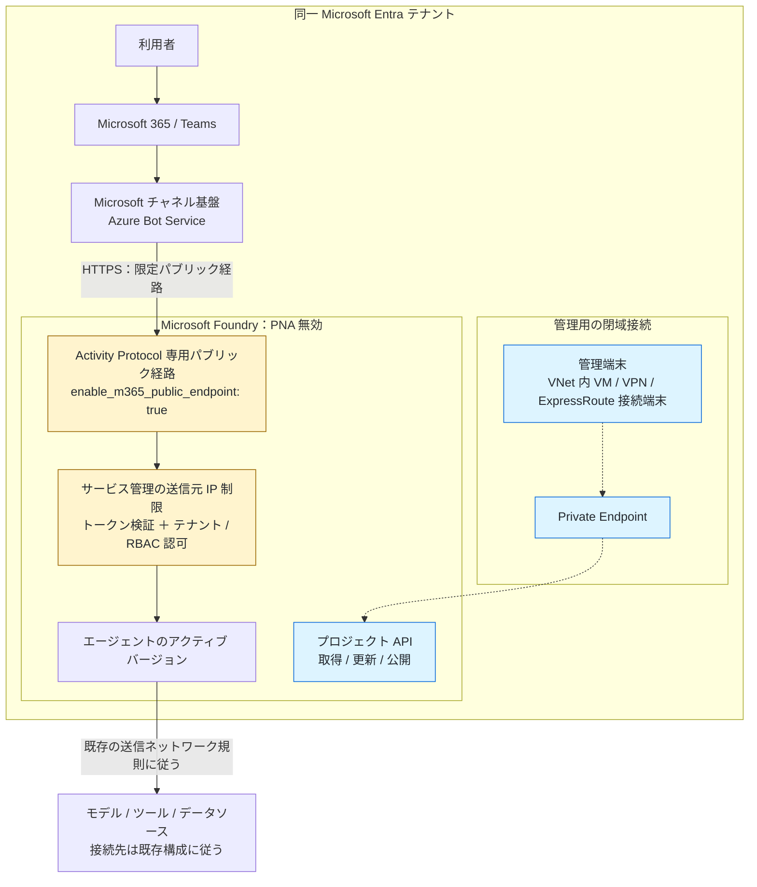

# private-foundry-m365: 同一テナントの Foundry エージェントを Microsoft 365 / Teams に公開する

[関連構成: Power Platform から別テナント Azure への閉域接続](https://github.com/ketana0224/private-PPF_Azure)

## 1. 目的と適用範囲

Microsoft 365（M365）と**同じ Microsoft Entra テナント**にある Microsoft Foundry の既存エージェントを、M365 / Microsoft Teams から利用できるようにします。Foundry のパブリック ネットワーク アクセス（PNA）は無効のまま、REST API で公開設定を行います。

本書は、末尾の Microsoft Learn 2 記事を基に、このリポジトリ向けに手順を整理したものです（参照確認日: 2026-10-27）。API や画面、提供状況は変更されるため、実施時にも公式ドキュメントを確認してください。

本書の手順を進めるには、PNA（Public Network Access）を無効にした Foundry をあらかじめ作成してください。なお、[関連構成: Power Platform から別テナント Azure への閉域接続](https://github.com/ketana0224/private-PPF_Azure)を構成済みの場合は、Foundry と M365 が同じテナントにあることなど、本書の前提条件を満たしていれば、その Foundry を利用して進められます。

### 関連する Power Platform 構成との違い

| 項目 | 関連する Power Platform リポジトリ | 本リポジトリ |
|---|---|---|
| エージェントの実行基盤 | Copilot Studio / Power Platform | Microsoft Foundry |
| 対象経路 | Power Platform → 別テナント Azure の MCP | M365 / Teams → 同一テナント Foundry |
| ネットワーク | サブネット インジェクションと Private Endpoint | Activity Protocol 専用のパブリック経路の例外 |
| テナント | 接続先 Azure は別テナントでも可 | Foundry と M365 は同じテナント |
| Power Platform 側の構築完了が必須か | — | 不要。既存の Foundry 環境から開始可能 |

既存の Copilot Studio エージェントが、この操作で Foundry エージェントに変換されるわけではありません。Foundry リソース、プロジェクト、モデル、エージェント、Private Endpoint の新規構築は本書の対象外です。

> **重要: 完全閉域の M365 接続ではありません。**
> M365 / Teams のチャネルは Foundry の Private Endpoint を使用しません。`enable_m365_public_endpoint: true` により、Activity Protocol ルートのみ、サービス管理の送信元 IP 制限付きパブリック経路を有効にします。Foundry アカウント全体の PNA は有効にしません。パブリック経路を一切許容できない要件では、この公開方式は採用できません。

## 2. 通信経路とテナント境界

```text
同一 Entra テナント <M365_FOUNDRY_TENANT_ID>
  利用者
    → M365 / Teams
    → Microsoft チャネル基盤 / Azure Bot Service
    → HTTPS: Foundry の Activity Protocol 専用パブリック経路
       [サービス管理の送信元 IP 制限 + トークン検証 + テナント / RBAC 認可]
    → Foundry エージェントのアクティブ バージョン
    → モデル / ツール / データソース（既存の送信ネットワーク規則に従う）

管理端末（VNet 内 VM、または VPN / ExpressRoute 接続端末）
    → Private Endpoint → Foundry プロジェクト API（取得 / 更新 / 公開）
```

実線は M365 / Teams からの利用経路、破線は閉域からの管理経路です。Teams の通信は Private Endpoint を通りません。



**M365 / Teams サービスと Bot Framework / Bot Connector Service の間は、Microsoft が運用するマネージドサービス間の接続です。この区間の通信基盤の保護とサービス間認証は Microsoft の責任範囲であり、利用者が証明書・サービス用資格情報・認証処理を構築・運用するものではありません。** 一方、Teams の利用・アプリポリシー、Bot のチャネル設定、Azure RBAC、Foundry 側の認可などの設定とアクセス管理は利用者側の責任です。責任分担は [Azure の共同責任モデル](https://learn.microsoft.com/en-us/azure/security/fundamentals/shared-responsibility)、Bot Connector Service による認証と正当なチャネルの検証は [Bot Framework セキュリティ FAQ](https://learn.microsoft.com/en-us/azure/bot-service/bot-service-resources-faq-security?view=azure-bot-service-4.0#how-does-the-bot-framework-handle-identity-and-access-management) を参照してください。

- `enable_m365_public_endpoint` は**受信側のみ**の設定です。ツールやモデルへの送信経路を作成・変更しません。
- `responses`、`invocations`、A2A、MCP、管理 API などは、この例外によってパブリック公開されません。
- パブリック IP、DNAT、リバース プロキシ、証明書や許可元 IP リストを利用者側で新設する必要はありません。送信元 IP 制限は Foundry が管理します。
- 送信元 IP 範囲は複数テナントで共有され得ます。**IP 制限だけでは同一テナントを保証できず、Bot Service の認証・認可も必須**です。
- 関連する Power Platform 構成と組み合わせる場合も、M365 と同じテナントに Foundry を置いてください。関連構成の `<SRC_TENANT_ID>` が別テナントなら、その側に置いた Foundry を本書の対象とはしません。

## 3. 前提条件

- M365 / Teams の組織テナントと Foundry を所有するテナントが一致していること。Azure サブスクリプションが存在するだけでは M365 の利用条件を満たしません。利用者のライセンス、アプリ利用・配布ポリシーは M365 管理者と確認してください。
- 新しい Foundry のプロジェクト エンドポイント `https://<resource-name>.services.ai.azure.com/api/projects/<project-name>` と、名前で取得できる既存エージェントがあること。本書は旧形式の Agent ID / API の手順ではありません。
- エージェントを Foundry でテスト済みで、公開するアクティブ バージョンを選択済みであること。本番はバージョン固定を推奨します。「常に最新」では、新バージョン作成がチャネルの応答にも反映されます。
- Foundry の PNA が無効で Private Endpoint が構成済みであること。実行端末でプロジェクト FQDN をプライベート IP に名前解決でき、HTTPS で到達できること。
- 実行端末から Azure サインイン、Azure Resource Manager などの管理先にも到達できること。
- **PowerShell 7 以上**、Azure CLI、および Bicep デプロイを実行できる環境。
- 次の権限・承認を用意すること。

| 作業 | 必要な権限・担当 |
|---|---|
| エージェントの取得・更新・公開 | プロジェクト スコープの **Foundry User** など、必要な操作を許可するロール |
| Bot の作成と Teams チャネルの構成 | 対象リソース グループの **Azure Bot Service Contributor**、Contributor、Owner など |
| リソース プロバイダーの登録 | サブスクリプションで登録できる権限。なければ管理者へ依頼 |
| `Shared` 公開後の利用 | 利用者に **Foundry Agent Consumer** など、対話に必要なプロジェクト権限 |
| `Tenant` での組織公開 | M365 管理者による承認と、組織のアプリ ポリシーへの適合 |

Foundry のロール名は旧称の Azure AI User などで表示される場合があります。Azure のロールと M365 管理者の権限は別です。

### 公開範囲を先に決める

| 用途 | `publishScope` | Bot 認可スキーム | 可視性・利用条件 |
|---|---|---|---|
| まず作成者で検証 | `Shared` | `BotServiceRbac` | ストアでは基本的に発行者の「あなたのエージェント」に表示。リンク共有や Teams チャットでの利用には、参加者にも必要な Foundry 権限が必要 |
| 組織内へ展開 | `Tenant` | `BotServiceTenant` | M365 管理者承認後、組織のエージェントとして表示。同一テナントのユーザーを認可 |

**`Shared` は「同一テナント全員に公開」の意味ではありません。** `Tenant` は利用者ごとの Foundry RBAC による絞り込みではないため、エージェントが扱う情報とツール権限を組織公開に適したものにしてください。ストアでの可視性と、エージェントを実行できるかは分けて確認します。

以降は `Shared` で検証する例です。組織公開では、手順 4 の `$publishScope` を `Tenant` に変更し、手順 9 の承認まで実施します。公開 API は範囲に応じた Bot 認可スキームを設定し、別の Bot スキームを置き換えるため、設定を一致させてください。

## 4. 変数と接続先を確認する

以降の PowerShell ブロックは、Private Endpoint に到達できる**同じ PowerShell 7 セッション**で順に実行します。`<...>` は自環境の値に置き換えてください。

### 一時的な設定ファイルを用意する

次の内容を、この README と同じフォルダーの `.env.local.ps1` に保存して編集します。このファイルは Git の追跡対象から除外しています。新しくクローンした環境では作成が必要です。

これは `.env` 形式ではなく、後続手順で使う **PowerShell セッション変数**を定義するファイルです。OS 全体や永続的な環境変数は変更しません。アクセストークン、パスワード、クライアント シークレットは保存しないでください。

**この手順では、既存の Foundry エージェントに接続するための Azure Bot リソースを、手順 6 で新規作成します。** Foundry エージェント自体を新しく作る手順ではありません。設定には「既存環境から確認して入力する値」と「今回新しく決める値」があります。設定ファイルを保存するだけでは、Azure リソースは作成されません。

```powershell
$tenantId = '<M365_FOUNDRY_TENANT_ID>'
$subscriptionId = '<FOUNDRY_SUBSCRIPTION_ID>'
$resourceGroup = '<FOUNDRY_RESOURCE_GROUP>'
$foundryAccountName = '<FOUNDRY_RESOURCE_NAME>'
$projectEndpoint = 'https://<resource-name>.services.ai.azure.com/api/projects/<project-name>'
$agentName = '<AGENT_NAME>'
$botName = 'bot-foundry-m365-dev-001'
$displayName = 'テストエージェント01'
$publishScope = 'Shared'
$appVersion = '1.0.0'
```

#### 既存環境から確認して入力する値

| 変数 | 何を指定するか |
|---|---|
| `$tenantId` | M365 と Foundry が属する、同一の Microsoft Entra テナント ID |
| `$subscriptionId` | Foundry がある Azure サブスクリプションの ID |
| `$resourceGroup` | Foundry がある既存のリソース グループ名。この手順では Bot も同じグループに作成 |
| `$foundryAccountName` | 既存の Foundry リソース名 |
| `$projectEndpoint` | 既存の Foundry プロジェクトのエンドポイント URL |
| `$agentName` | 接続する既存の Foundry エージェントの名前。Bot の名前やエージェント ID ではない |

#### 今回新しく決める値

| 変数 | 何を指定するか | 上の設定例 |
|---|---|---|
| `$botName` | 新規作成する Azure Bot のリソース名。既存の Bot と重複しない名前を指定 | `bot-foundry-m365-dev-001` |
| `$displayName` | 人が読む表示名。手順 6 の Azure Bot の表示名と、手順 8 の M365 / Teams 発行時の `agentDisplayName` に使用 | `テストエージェント01` |
| `$publishScope` | 公開範囲。まず `Shared` で検証し、組織展開時に `Tenant` へ切り替える | `Shared` |
| `$appVersion` | M365 / Teams へ発行するアプリのバージョン。Foundry エージェントの実装バージョンとは別 | `1.0.0` |

`$botName` の例は、Microsoft の[推奨略称](https://learn.microsoft.com/ja-jp/azure/cloud-adoption-framework/ready/azure-best-practices/resource-abbreviations)である `bot` をプレフィックスにし、用途 `foundry-m365`、環境 `dev`、連番 `001` を続けています。この形式は Azure の必須形式ではありません。組織の命名規則があれば優先し、作成前に名前の重複を確認してください。

`$displayName` は、エージェントの用途に合わせた読みやすい名前に変更してください。`bot-` のようなリソース種別のプレフィックスは不要です。表示名を指定しても、別のリソースが増えたり、既存の Foundry エージェント名が変更されたりするわけではありません。

### 設定を読み込んで接続先を確認する

リポジトリ ルートをカレント ディレクトリにして実行します。先頭の `. `（ドットとスペース）が必要です。設定ファイルも PowerShell コードとして実行されるため、自分で内容を確認したものだけを読み込んでください。

```powershell
$ErrorActionPreference = 'Stop'
. .\.env.local.ps1

if ($publishScope -notin @('Shared', 'Tenant')) {
    throw 'publishScope must be Shared or Tenant.'
}
$botAuthorization = if ($publishScope -eq 'Tenant') { 'BotServiceTenant' } else { 'BotServiceRbac' }
$projectEndpoint = $projectEndpoint.TrimEnd('/')
$agentUrl = "$projectEndpoint/agents/$([uri]::EscapeDataString($agentName))"
$activityEndpoint = "$agentUrl/endpoint/protocols/activityprotocol?api-version=2025-11-15-preview"

# バックアップとテンプレートはリポジトリ外の作業フォルダーへ保存する。
$workDir = Join-Path ([System.IO.Path]::GetTempPath()) ("foundry-m365-" + [guid]::NewGuid())
New-Item -ItemType Directory -Path $workDir | Out-Null
Write-Host "Work directory: $workDir"

az login --tenant $tenantId
if ($LASTEXITCODE -ne 0) { throw 'Azure login failed.' }
az account set --subscription $subscriptionId
if ($LASTEXITCODE -ne 0) { throw 'Subscription selection failed.' }
$actualTenant = az account show --query tenantId -o tsv
if ($LASTEXITCODE -ne 0) { throw 'Tenant lookup failed.' }
if ($actualTenant.Trim() -ne $tenantId) { throw 'Selected subscription belongs to a different tenant.' }

az cognitiveservices account show --name $foundryAccountName --resource-group $resourceGroup `
    --query properties.publicNetworkAccess -o tsv
if ($LASTEXITCODE -ne 0) { throw 'Foundry network configuration lookup failed.' }
```

M365 管理センター側のテナント ID と `$tenantId` の一致を別途確認します。PNA の出力が `Disabled` であることも確認してください。本書では PNA を変更しません。

```powershell
Resolve-DnsName ([uri]$projectEndpoint).Host
Test-NetConnection -ComputerName ([uri]$projectEndpoint).Host -Port 443

az provider register --namespace Microsoft.BotService --wait
if ($LASTEXITCODE -ne 0) { throw 'Microsoft.BotService registration failed.' }
```

名前解決が対象 Private Endpoint のプライベート IP になり、TCP 443 に到達できることを確認してから進めます。TCP 疎通だけでは API の認証・認可の確認にはなりません。

## 5. エージェントを取得し、既存設定を保存する

この手順では、既存の Foundry エージェントの設定を取得し、変更前のバックアップとして **`$workDir` 配下に `agent-before.json` という名前で保存します**。`$workDir` は手順 4 で作成した、PowerShell を実行している端末内の一時作業フォルダーです。カレント フォルダーや Azure 上に保存するわけではありません。この段階ではエージェントの設定は変更しません。

保存先のフルパスは、次のコマンドで確認できます。

```powershell
Join-Path $workDir 'agent-before.json'
```

プロジェクト API には、ARM 用ではなく `https://ai.azure.com` 向けのトークンを使用します。トークンを画面に出力したりファイルに保存したりしないでください。有効期限切れの場合は、このトークン取得部分を再実行します。

```powershell
$token = az account get-access-token --resource https://ai.azure.com --query accessToken -o tsv
if ($LASTEXITCODE -ne 0 -or [string]::IsNullOrWhiteSpace($token)) {
    throw 'Foundry access token acquisition failed.'
}
$headers = @{ Authorization = "Bearer $($token.Trim())" }

$agent = Invoke-RestMethod -Method Get -Uri "${agentUrl}?api-version=v1" -Headers $headers
$agent | ConvertTo-Json -Depth 100 |
    Set-Content -LiteralPath (Join-Path $workDir 'agent-before.json') -Encoding utf8NoBOM

$clientId = $agent.instance_identity.client_id
if ([string]::IsNullOrWhiteSpace($clientId)) {
    throw 'Agent instance_identity.client_id is missing. Check the agent identity before continuing.'
}
$clientId
```

Bot の `msaAppId` に指定するのは **`instance_identity.client_id`** です。`principal_id`、エージェント名、任意のアプリ登録 ID に置き換えないでください。

バックアップにはエージェント設定が含まれます。組織の管理ルールに従って保管し、リポジトリへコミットしないでください。

## 6. Azure Bot Service と Teams チャネルを作成する

以下を作業フォルダーの `bot-service.bicep` として保存します。Foundry と同じテナントの、ここでは同じサブスクリプション / リソース グループに作成します。

このテンプレートは、リソース名 `$botName`、表示名 `$displayName` の Azure Bot と、その配下の Teams チャネル設定を作成します。既存の Foundry エージェントには、手順 5 で取得したクライアント ID と Activity Protocol の URL を使って接続します。

```bicep
param botName string
param displayName string
param agentClientId string
param tenantId string
param activityEndpoint string

resource bot 'Microsoft.BotService/botServices@2022-09-15' = {
  name: botName
  location: 'global'
  kind: 'azurebot'
  sku: {
    name: 'F0'
  }
  properties: {
    displayName: displayName
    endpoint: activityEndpoint
    msaAppId: agentClientId
    msaAppTenantId: tenantId
    msaAppType: 'SingleTenant'
    publicNetworkAccess: 'Disabled'
  }
}

resource teams 'Microsoft.BotService/botServices/channels@2021-03-01' = {
  parent: bot
  name: 'MsTeamsChannel'
  location: 'global'
  properties: {
    channelName: 'MsTeamsChannel'
  }
}

output botServiceArmId string = bot.id
```

次を実行します。既存 Bot と衝突しない新しい名前を指定してください。

```powershell
$templatePath = Join-Path $workDir 'bot-service.bicep'
if (-not (Test-Path -LiteralPath $templatePath)) { throw "Save the Bicep template to $templatePath first." }

$deploymentJson = az deployment group create --resource-group $resourceGroup `
    --template-file $templatePath `
    --parameters botName=$botName displayName="$displayName" agentClientId=$clientId `
        tenantId=$tenantId activityEndpoint=$activityEndpoint -o json
if ($LASTEXITCODE -ne 0) { throw 'Bot Service deployment failed.' }
$deployment = ($deploymentJson -join "`n") | ConvertFrom-Json
$botServiceArmId = $deployment.properties.outputs.botServiceArmId.value
if ([string]::IsNullOrWhiteSpace($botServiceArmId)) { throw 'Bot Service ARM ID is missing.' }
```

`SingleTenant`、`msaAppTenantId`、`msaAppId`、Activity Protocol の URL を確認します。Bot の PNA も `Disabled` のままです。これは Foundry の Activity Protocol 例外とは別の設定であり、Bot / Foundry の PNA 全体を有効にする必要はありません。

## 7. Activity Protocol の例外と認可を設定する

**PATCH は `protocol_configuration` と `authorization_schemes` を置き換えます。** 最小サンプルだけを送ると既存の Responses / MCP / A2A などの設定を失う恐れがあります。

以下は手順 5 の取得結果を基に、既存設定を保持しつつ Activity と選択した Bot 認可を設定します。別の管理者による更新と競合しない時間帯で実行し、取得から時間が空いた場合は手順 5 を再実行してください。

```powershell
$endpointConfig = $agent.agent_endpoint | ConvertTo-Json -Depth 100 | ConvertFrom-Json -AsHashtable
if ($null -eq $endpointConfig) { throw 'agent_endpoint is missing. Inspect the agent configuration.' }

$protocols = $endpointConfig['protocol_configuration']
if ($null -eq $protocols) { $protocols = @{} }
if ($null -eq $protocols['activity']) { $protocols['activity'] = @{} }
$protocols['activity']['enable_m365_public_endpoint'] = $true

$schemes = @(
    $endpointConfig['authorization_schemes'] |
        Where-Object { $null -ne $_ -and $_['type'] -notin @('BotServiceRbac', 'BotServiceTenant') }
)
$schemes += @{ type = $botAuthorization }

$patchBody = @{
    agent_endpoint = @{
        protocol_configuration = $protocols
        authorization_schemes = $schemes
    }
} | ConvertTo-Json -Depth 100

# 送信前に、保持対象のプロトコルと認可スキームがすべて含まれることを確認する。
$patchBody
$updated = Invoke-RestMethod -Method Patch -Uri "${agentUrl}?api-version=v1" `
    -Headers $headers -ContentType 'application/merge-patch+json' -Body $patchBody

$configured = Invoke-RestMethod -Method Get -Uri "${agentUrl}?api-version=v1" -Headers $headers
$configured.agent_endpoint | ConvertTo-Json -Depth 100
```

確認事項:

- `protocol_configuration.activity.enable_m365_public_endpoint` が `true`。
- `$publishScope` に対応する Bot 認可スキームが存在する。
- 既存のプロトコルと、`AzureRbac` / `Entra` など既存の非 Bot 認可設定が維持されている。
- `AzureRbac` とその別名 `Entra` を新たに両方設定しない。これらの直接呼び出し用スキームだけでは、M365 チャネル通信を認可できない。

## 8. M365 / Teams へ発行する

開発者情報と URL は、**実際に組織が提供する情報**に置き換えます。メタデータは利用者に表示されるため、秘密情報を含めないでください。

`agentDisplayName` には手順 4 の `$displayName` を使用します。この手順では、Azure Bot の表示名と M365 / Teams へ発行するエージェントの表示名をそろえています。`shortDescription` と `fullDescription` の例も、実際のエージェントの用途に合わせて変更してください。

```powershell
$publishRequest = @{
    agentDisplayName = $displayName
    botServiceArmId = $botServiceArmId
    publishScope = $publishScope
    publishAsAutopilot = $false
    appVersion = $appVersion
    shortDescription = 'Contoso policy assistant'
    fullDescription = 'Answers policy questions using the configured Foundry agent.'
    developerName = '<ORGANIZATION_NAME>'
    developerWebsiteUrl = 'https://<YOUR_ORGANIZATION_HOST>'
    privacyUrl = 'https://<YOUR_ORGANIZATION_HOST>/privacy'
    termsOfUseUrl = 'https://<YOUR_ORGANIZATION_HOST>/terms'
}
$publishBody = $publishRequest | ConvertTo-Json -Depth 100
$published = Invoke-RestMethod -Method Post `
    -Uri "$agentUrl/microsoft365/publish?api-version=v1" `
    -Headers $headers -ContentType 'application/json' -Body $publishBody
$published | ConvertTo-Json -Depth 100
if ([string]::IsNullOrWhiteSpace($published.titleId)) {
    throw 'Publish response did not contain titleId. Inspect the response before continuing.'
}
```

成功応答の `titleId` を作業記録に残します。HTTP エラーが発生した場合は先へ進まず、応答内容を確認してください。

- URL には**エージェント名**を使用します。本文にエージェント GUID や Bot ID を追加する方式ではありません。`botServiceArmId` は手順 6 の ARM リソース ID です。
- 同一の `appVersion` を再発行するとバージョン重複エラーになるため、表示情報や公開範囲を変えて再発行するときは、例えば `1.0.1` に上げます。
- 応答するエージェントのバージョンは Foundry のアクティブ バージョン設定で管理します。`appVersion` はエージェント実装のバージョンではありません。

### 任意: 発行前にアプリ パッケージを確認する

カタログに送信する前に確認したい場合は、上の POST を実行する**前**に、同じ `$publishBody` で次を実行します。

```powershell
$packagePath = Join-Path $workDir 'appPackage.zip'
Invoke-WebRequest -Method Post -Uri "$agentUrl/microsoft365/zip?api-version=v1" `
    -Headers $headers -ContentType 'application/json' -Body $publishBody -OutFile $packagePath
Expand-Archive -LiteralPath $packagePath -DestinationPath (Join-Path $workDir 'appPackage')
```

展開した `manifest.json` と参照されるアイコンなどを確認します。ZIP 取得だけではカタログへの発行や発行レコードの作成は行われません。ただし、パッケージ準備によってエージェントのエンドポイント設定が更新され得るため、読み取り専用の操作ではなくエージェントの書き込み権限が必要です。

## 9. 管理者承認と利用者への展開

### `Shared` の場合

1. 発行したユーザーで、同じテナントの M365 / Teams にサインインします。
2. エージェント ストアの「あなたのエージェント」などから対象を探して追加します。
3. 他の利用者にリンク共有する場合や Teams チャットへ追加する場合は、参加者にも必要な Foundry プロジェクト権限があることを確認します。共有リンクだけで RBAC は付与されません。

### `Tenant` の場合

1. M365 管理者が [Microsoft 365 管理センターのエージェント承認画面](https://admin.cloud.microsoft/?#/agents/all/requested)で要求を確認します。
2. 名前、説明、開発者情報、権限、データの取り扱いと公開範囲を審査し、組織のポリシーに従って承認します。
3. 承認・配布反映後、利用者がエージェント ストアの「組織によって構築された（Built by your org）」などから追加します。

管理者承認と Azure 側の発行成功は別の段階です。ストアに表示されない場合は、発行したテナント、公開範囲、承認状態、アプリ ポリシーと反映状況を確認します。

## 10. 完了確認

API の発行成功だけで完了とせず、以下を確認してください。

- [ ] M365 と Foundry のテナント ID が一致している。
- [ ] Foundry と Bot の PNA は `Disabled` のまま。
- [ ] 発行後も GET で Activity の例外と、公開範囲に一致した Bot 認可設定を確認できる。
- [ ] 既存の Responses / MCP / A2A など、保持対象の設定と直接クライアントの動作が維持されている。
- [ ] `Shared` は適切な RBAC を持つ検証利用者で、`Tenant` は承認後に対象の組織利用者で、M365 / Teams から会話できる。
- [ ] 例えば「返品ポリシーを教えて」と送信し、想定したアクティブ バージョンの応答が返る。
- [ ] ツールを使用する場合は実際に呼び出されること、送信先への到達性と認証が維持されていることを確認する。単なる挨拶への応答だけで MCP 等の疎通成功としない。
- [ ] 一般のパブリック接続元からプロジェクト API を呼んでも、アクセスが許可されない。
- [ ] 未認可ユーザーの利用が拒否される。`BotServiceRbac` は権限のない同一テナント利用者、`BotServiceTenant` は別テナントのテスト利用者などで、実施可能な範囲で確認する。

Activity ルートは一般のパブリック端末からの直接テストも送信元 IP 制限の対象です。その端末で拒否されることと、正規の M365 チャネルで成功することの両方を確認します。

## 11. トラブルシューティング

| 症状 | 主な確認先 |
|---|---|
| プロジェクト API がタイムアウト / ネットワーク拒否 | 管理端末の PE 到達性、Private DNS、VPN / ExpressRoute。Activity の例外は管理 API を公開しない |
| API が 401 / 403 | トークンの期限と audience `https://ai.azure.com`、選択テナント、プロジェクト スコープの RBAC |
| Bot デプロイが失敗 | Bot 名の競合、`Microsoft.BotService` 登録、対象 RG の作成権限、デプロイ エラー |
| ストアにはあるが会話できない | Activity 例外、Bot の endpoint / `client_id` / tenant、Teams チャネル、公開範囲と Bot 認可の整合 |
| `Shared` を共有した相手だけ利用できない | 相手の Foundry RBAC とサインイン先テナント。共有リンクはアクセス権を付与しない |
| `Tenant` がストアに出ない | M365 管理者の承認、アプリ ポリシー、配布反映、利用者が所属するテナント |
| `version already exists` | `appVersion` を更新。エージェントのアクティブ バージョンとは区別する |
| 会話できるがモデル / MCP / データアクセスが失敗 | Foundry ランタイムの送信規則、Private DNS、ツール認証。M365 受信設定は送信経路を変更しない |
| 既存の直接クライアントが動かなくなった | PATCH で既存プロトコル・認可を落としていないか、バックアップと照合 |

詳細は [Microsoft Learn の公開トラブルシューティング](https://learn.microsoft.com/azure/foundry/agents/how-to/troubleshoot-publish-copilot)を参照してください。原因調査のために Foundry 全体の PNA を有効化することは、本書の解決策ではありません。

## 12. 公開停止・復旧・運用上の注意

- **M365 経路を停止する**: 手順 5 で最新設定を再取得した上で、手順 7 の `enable_m365_public_endpoint` を `$false` にして PATCH します。既存の他プロトコル・認可は保持してください。これにより、PNA 無効の環境ではパブリック Activity 要求がブロックされます。
- **カタログからの利用停止も行う**: 上記の通信停止だけでは M365 / Teams の掲載やインストール済みアプリは削除されません。M365 管理者が組織の管理画面でブロック・削除などを行い、利用者側でも必要に応じて削除します。
- **構成を復旧する**: `agent-before.json` のエンドポイント設定を確認し、復旧対象の `protocol_configuration` と `authorization_schemes` だけを PATCH 本文へ指定します。GET の応答全体をそのまま PATCH しないでください。その後の正当な変更も上書きしないようにします。
- **Bot を削除する**: 他の公開で利用されていないことを確認し、本書で作成した Bot のみを削除します。既存 Foundry やリソース グループ全体は削除しません。
- **作業データを整理する**: バックアップの保管要否を確認してから、本書で作成した作業ファイルを個別に削除し、セッションの `$token` と `$headers` を破棄します。トークンやエージェント設定を Git に保存しないでください。
- **一時設定を削除する**: 検証終了後、不要になった `.env.local.ps1` を個別に削除します。PowerShell を終了するとセッション変数も破棄されます。Git 除外は暗号化やアクセス制限ではないため、実値を記入したファイルの取り扱いにも注意してください。
- **データの扱い**: 名前・説明・アイコンに加えて、利用時の応答などのデータが M365 / Teams で処理・保存され得ます。Foundry の閉域設定だけでデータ所在地・コンプライアンス要件が満たされるとは判断せず、M365 / Teams 側の条件も審査します。
- **機能制限**: 参照時点では、公開エージェントのストリーミング応答と引用は非対応です。M365 ではファイル アップロードと画像生成も非対応とされています（Teams とは対応状況が異なります）。利用要件は最新の公式記事で確認してください。

## 参考ドキュメント

- [Microsoft Foundry エージェントの設定と共有: Allow Microsoft 365 traffic to a private-network agent](https://learn.microsoft.com/en-us/azure/foundry/agents/how-to/configure-agent?tabs=portal#allow-microsoft-365-traffic-to-a-private-network-agent)
- [REST API を使用してエージェントを Microsoft 365 および Teams に発行する](https://learn.microsoft.com/ja-jp/azure/foundry/agents/how-to/publish-copilot-virtual-network?view=foundry)
- [Foundry エージェントのプライベート ネットワーク構成](https://learn.microsoft.com/azure/foundry/agents/how-to/virtual-networks)
- [エージェント エンドポイント認可の構成](https://learn.microsoft.com/azure/foundry/agents/how-to/configure-agent-endpoint-authorization)
